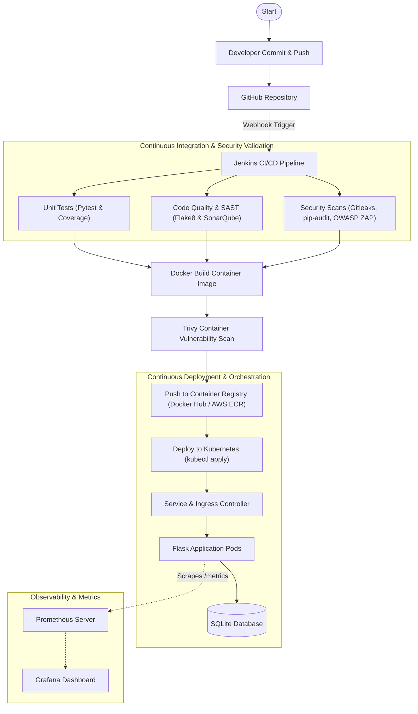

# FinTrack Pro: Cloud-Native Personal Finance Tracker with DevSecOps Pipeline

> **Course**: ADVANCEMENTS IN CLOUD AND DEVOPS (INT378)  
> **Title**: Design and Implementation of a Cloud-Native DevOps Pipeline for a Personal Finance Application  
> **Student**: Neha Fathima | **Registration No**: 12318557 | **Section**: K4O2311 | **Roll No**: 55  
> **Submitted To**: Ms. Arshiya  

---

## 1. Project Overview & Architecture

**FinTrack Pro** is a cloud-native, full-stack Personal Finance Management Web Application engineered with **Python Flask**, **SQLAlchemy**, and **SQLite**, containerized using **Docker**, orchestrated across **Kubernetes**, provisioned through **AWS CloudFormation Infrastructure as Code (IaC)**, and delivered via a complete **Jenkins DevSecOps CI/CD Pipeline** with automated security gates (**SonarQube**, **Gitleaks**, **pip-audit**, **Trivy**, **OWASP ZAP**) and operational observability through **Prometheus & Grafana**.

### Architecture Layers (Report Section 6)

| Layer | Technology | Purpose |
| :--- | :--- | :--- |
| **Frontend** | HTML5, CSS3, Bootstrap 5, JavaScript | Responsive, modern, interactive user interface |
| **Visualization** | **Chart.js** | Interactive financial charts (Income vs Expense, Category Breakdown) |
| **Template Engine** | Jinja2 | Dynamic HTML templating and session-aware UI components |
| **Backend** | Python & Flask | RESTful controller, session authentication, and API endpoints |
| **ORM** | SQLAlchemy | Object Relational Mapping and schema abstraction |
| **Database** | SQLite (Persisted via PVC / Volume) | Relational database storage |
| **Reporting** | ReportLab | Exportable PDF financial reporting |
| **Version Control** | Git & GitHub | Source code management and CI webhook triggers |
| **CI/CD** | Jenkins | Automated declarative pipeline (build, test, scan, package, deploy) |
| **Containerization**| Docker & Docker Compose | Lightweight, secure, multi-stage OCI container image |
| **Orchestration** | Kubernetes | Container orchestration, ingress, service discovery, self-healing, HPA |
| **IaC** | AWS CloudFormation | Declarative cloud infrastructure (VPC, Subnets, ALB, ECR, ECS) |
| **Security (DevSecOps)** | SonarQube, Gitleaks, pip-audit, Trivy, OWASP ZAP | Automated SAST, secret detection, CVE audits, container scanning, DAST |
| **Monitoring** | Prometheus | Metric collection, scraping application metrics via `/metrics` |
| **Dashboards** | Grafana | Operational telemetry, request rates, latencies, and business KPIs |

---

## 2. DevSecOps & CI/CD Pipeline (Report Section 6 & 8)

The continuous delivery pipeline implemented in [`Jenkinsfile`](file:///c:/Users/DELL/Downloads/financetrackerproject-main/Jenkinsfile) executes the following automated lifecycle:



### DevSecOps Security Tools Matrix (Report Section 8 & 9)

1. **SonarQube (`sonar-project.properties`)**: Performs Static Application Security Testing (SAST) and code quality gate evaluation.
2. **Gitleaks (`.gitleaks.toml`)**: Detects inadvertently committed passwords, private keys, and API tokens.
3. **pip-audit (`requirements.txt`)**: Analyzes Python third-party packages against known CVE vulnerability databases.
4. **Aqua Trivy**: Scans the compiled Docker container base image and OS packages for High/Critical CVEs prior to registry push.
5. **OWASP ZAP**: Executes Dynamic Application Security Testing (DAST) baseline scans against active web endpoints.
6. **Kubernetes Security Policies (`k8s/network-policy.yaml`)**: Enforces non-root execution (`runAsNonRoot: true`, UID 1000), drops kernel capabilities, and isolates pod-to-pod network traffic.

---

## 3. Directory Structure

```text
financetrackerproject-main/
├── .dockerignore                            # Exclusions for Docker build context
├── .gitignore                               # Git source control ignores
├── .gitleaks.toml                           # Gitleaks secret detection configuration
├── Dockerfile                               # Multi-stage secure Python container image
├── docker-compose.yml                       # Full-stack orchestrator (App + Prometheus + Grafana)
├── Jenkinsfile                              # Declarative DevSecOps CI/CD pipeline
├── sonar-project.properties                 # SonarQube SAST configuration
├── pytest.ini                               # Pytest unit testing suite configuration
├── requirements.txt                         # Application & DevSecOps dependencies
├── config.py                                # Environment configuration classes (Dev, Test, Prod)
├── models.py                                # SQLAlchemy models (User, Income, Expense, Budget)
├── app.py                                   # Central Flask web app, APIs, & Prometheus metrics
├── routes.py                                # Modular route interface for extensibility
│
├── cloudformation/
│   └── infrastructure.yaml                  # AWS CloudFormation template (VPC, ALB, ECR, ECS)
│
├── k8s/                                     # Kubernetes orchestration manifests
│   ├── namespace.yaml                       # Isolated namespace: finance-tracker
│   ├── configmap.yaml                       # Application runtime configuration
│   ├── secret.yaml                          # Encrypted secret keys
│   ├── pvc.yaml                             # PersistentVolumeClaim for SQLite database
│   ├── deployment.yaml                      # 2-replica Deployment with probes & securityContext
│   ├── service.yaml                         # ClusterIP / LoadBalancer service (Port 80/8000)
│   ├── ingress.yaml                         # Ingress controller rules
│   ├── network-policy.yaml                  # DevSecOps network isolation policy
│   ├── hpa.yaml                             # Horizontal Pod Autoscaler (CPU/Memory scaling)
│   └── kustomization.yaml                   # Kustomize deployment bundle
│
├── monitoring/
│   ├── prometheus/
│   │   └── prometheus.yml                   # Prometheus scrape configuration for /metrics
│   └── grafana/
│       ├── provisioning/
│       │   ├── datasources/datasource.yml   # Auto-provisioned Prometheus data source
│       │   └── dashboards/dashboards.yml    # Auto-provisioned dashboard provider
│       └── dashboards/
│           └── finance-tracker-dashboard.json# Pre-built monitoring dashboard
│
├── scripts/
│   └── devsecops_audit.py                   # Automated local/CI DevSecOps security runner
│
├── static/
│   ├── css/style.css                        # Modern custom styling
│   └── charts/                              # Fallback visual assets
│
├── templates/                               # Jinja2 responsive templates
│   ├── base.html                            # Master template with Chart.js & dynamic session navbar
│   ├── index.html                           # Landing page
│   ├── login.html                           # Secure user login
│   ├── register.html                        # User registration with password hashing
│   ├── dashboard.html                       # Financial overview with interactive Chart.js graphs
│   ├── add_income.html                      # Income entry form
│   ├── add_expense.html                     # Expense entry form
│   ├── edit_income.html                     # Income modification
│   ├── edit_expense.html                    # Expense modification
│   ├── transactions.html                    # Searchable transaction history
│   ├── monthly_report.html                  # Monthly filtering & summary
│   └── set_budget.html                      # Monthly budget configuration
│
└── tests/
    └── test_app.py                          # Comprehensive Pytest test suite (21 unit/integration tests)
```

---

## 4. Key Endpoints & APIs

- **`GET /`**: Public landing page and feature summary.
- **`GET /register` & `POST /register`**: User account registration with secure password hashing (`generate_password_hash`).
- **`GET /login` & `POST /login`**: User authentication with session verification (`check_password_hash`).
- **`GET /logout`**: Clears user session.
- **`GET /dashboard`**: Protected personal finance dashboard with **Chart.js** dynamic bar & doughnut charts.
- **`POST /add_income` & `POST /add_expense`**: Records financial inflows and categorized outflows.
- **`GET /transactions?search=<query>`**: Filtered search across income sources and expense categories.
- **`GET /monthly_report?month=<01-12>`**: Aggregates records by selected month.
- **`GET /download_report`**: Generates and downloads a formatted PDF report via ReportLab.
- **`GET /health`**: Health verification endpoint for Kubernetes Liveness/Readiness probes and AWS ALB. Returns:
  ```json
  {
    "status": "healthy",
    "service": "personal-finance-tracker",
    "database": "healthy",
    "uptime_seconds": 120,
    "version": "1.0.0"
  }
  ```
- **`GET /metrics`**: Prometheus-compliant metrics exposition endpoint exporting:
  - `fintrack_http_requests_total`
  - `fintrack_http_request_duration_seconds`
  - `fintrack_registered_users_total`
  - `fintrack_income_total_amount`
  - `fintrack_expense_total_amount`
  - `fintrack_transactions_total`
  - `fintrack_budget_amount`
- **`GET /api/chart-data`**: REST JSON endpoint delivering live category aggregations to Chart.js.

---

## 5. Running the Application

### Option A: Local Python Development
```bash
# 1. Create and activate virtual environment
python -m venv venv
# Windows:
.\venv\Scripts\activate
# Linux/macOS:
source venv/bin/activate

# 2. Install dependencies
pip install -r requirements.txt

# 3. Run test suite
pytest

# 4. Start Flask application
python app.py
```
Access the application at `http://localhost:8000`.

---

### Option B: Full-Stack Docker Compose (App + Prometheus + Grafana)
```bash
# Build and launch all 3 services in background
docker compose up -d --build

# Verify running containers
docker compose ps
```
Services will be accessible at:
- **Finance Tracker Web App**: `http://localhost:8000`
- **Prometheus Monitoring Server**: `http://localhost:9090`
- **Grafana Dashboard UI**: `http://localhost:3000` *(Login: admin / admin)*

---

### Option C: Kubernetes Deployment
Deploy using `kubectl` or `kustomize`:
```bash
# Apply the complete Kubernetes manifests
kubectl apply -k k8s/

# Verify pods, services, ingress, and HPA
kubectl get pods -n finance-tracker
kubectl get svc -n finance-tracker
kubectl get ingress -n finance-tracker
kubectl get hpa -n finance-tracker
```

---

### Option D: AWS CloudFormation Provisioning
Deploy the complete AWS cloud architecture using the AWS CLI:
```bash
aws cloudformation create-stack \
  --stack-name fintrack-production \
  --template-body file://cloudformation/infrastructure.yaml \
  --capabilities CAPABILITY_NAMED_IAM
```

---

## 6. Running DevSecOps Security Audits

Execute automated security scans directly using the auditor script:
```bash
python scripts/devsecops_audit.py --tool all
```
Generated reports are automatically saved under `reports/` for Jenkins CI/CD archiving:
- `reports/test-results.xml` (JUnit test report)
- `reports/coverage.xml` (Code coverage)
- `reports/flake8-report.txt` (Code quality findings)
- `reports/pip-audit-report.json` (Dependency CVE scan)
- `reports/gitleaks-report.json` (Secret detection scan)
- `reports/trivy-report.json` (Container vulnerability scan)
